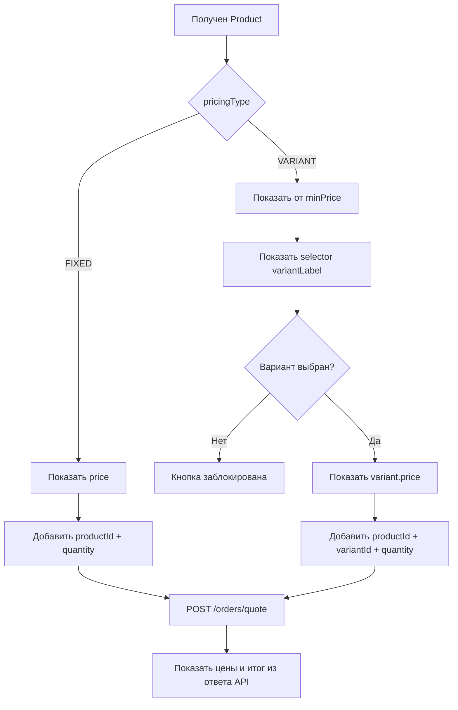

# Блюда с вариантами: контракт фронтенда

## Бизнес-правило

У блюда есть ровно один режим продажи:

- `FIXED` — блюдо продаётся само по одной цене;
- `VARIANT` — блюдо нельзя добавить в заказ без выбора активного варианта.

Основная цена и варианты не смешиваются. Доплата за сыр, соус или другую
добавку — это будущий модификатор, а не вариант блюда.

## Как показывать клиенту

### Одна цена (`FIXED`)

```text
┌─────────────────────────────────┐
│ 🥖  Лепёшка                     │
│      Одна цена                  │
│      8.00 TMT      [Добавить]   │
└─────────────────────────────────┘
```

- показать `product.price`;
- не показывать выбор вариантов;
- в корзину записать `productId + quantity`;
- `variantId` не отправлять.

### Несколько вариантов (`VARIANT`)

До выбора:

```text
┌──────────────────────────────────────────┐
│ 🥟  Сомса                                │
│                                          │
│ Тип начинки                              │
│ [ Выберите вариант                  ▾ ]  │
│                                          │
│ от 25.00 TMT                             │
│ [      Сначала выберите вариант       ]  │
└──────────────────────────────────────────┘
```

После выбора:

```text
┌──────────────────────────────────────────┐
│ 🍖  Сомса                                │
│                                          │
│ Тип начинки                              │
│ [ Нарезанное мясо — 30.00 TMT       ▾ ] │
│                                          │
│ 30.00 TMT                                │
│ [          Добавить в корзину         ]  │
└──────────────────────────────────────────┘
```

- до выбора показывать `от {product.minPrice}`;
- использовать `product.variantLabel` как подпись selector;
- не выбирать самый дешёвый вариант автоматически;
- блокировать изменение количества и добавление, пока вариант не выбран;
- после выбора показывать `variant.price` без слова `от`;
- использовать первое фото варианта, а при его отсутствии — фото блюда;
- в корзину записать `productId + variantId + quantity`.

## Поток



## Ответ каталога

```json
{
  "id": "product-id",
  "name": "Сомса",
  "pricingType": "VARIANT",
  "price": 25,
  "minPrice": 25,
  "hasVariants": true,
  "variantLabel": "Тип начинки",
  "displayImageUrl": "/api/v1/media/product.webp",
  "variants": [
    {
      "id": "variant-minced",
      "name": "Фарш",
      "price": 25,
      "isActive": true,
      "images": []
    },
    {
      "id": "variant-chopped",
      "name": "Нарезанное мясо",
      "price": 30,
      "isActive": true,
      "images": []
    }
  ]
}
```

Для `VARIANT` поле `price` остаётся совместимым и равно минимальной активной
цене. Новый фронтенд использует `minPrice` до выбора и `variant.price` после
выбора. Режим определяется только по `pricingType`, не по `variants.length` и
не по `hasVariants`.

Публичный каталог не возвращает неактивные варианты и полностью скрывает
`VARIANT`-блюдо, если у него нет активного варианта. Админский каталог возвращает
и неактивные варианты для редактирования.

## Корзина и заказ

Разные варианты одного блюда являются разными строками корзины. Стабильный
ключ строки:

```ts
const cartItemKey = `${productId}:${variantId ?? "fixed"}`;
```

Запрос для блюда с вариантом:

```json
{
  "items": [
    {
      "productId": "product-id",
      "variantId": "variant-chopped",
      "quantity": 2
    }
  ]
}
```

Для `FIXED` поле `variantId` отсутствует. Фронтенд никогда не отправляет цену.
Перед оформлением он вызывает `POST /orders/quote` и показывает `unitPrice`,
скидки, доставку и итог из ответа бэкенда. Создание заказа повторно проверяет
доступность и цену.

Сервер временно выбирает самый дешёвый активный вариант при отсутствии
`variantId` для совместимости со старыми клиентами. Новый фронтенд не должен
использовать этот fallback.

## Админская форма

Первое ценовое поле формы — `Как продаётся блюдо`:

```text
[ Одна цена | Несколько вариантов ]
```

Для `FIXED`:

- показать обязательную цену;
- скрыть редактор вариантов;
- отправить `pricingType: "FIXED"`, `price` и пустой `variants`;
- при переключении из `VARIANT` потребовать новую цену.

Для `VARIANT`:

- скрыть основную цену;
- потребовать `variantLabel`;
- потребовать минимум один вариант и минимум один активный вариант;
- у каждого варианта требовать уникальное название и неотрицательную цену;
- отправить `pricingType: "VARIANT"`, `variantLabel` и `variants` без основной
  цены.

Бэкенд сам сохраняет минимальную цену активного варианта. При переключении
`VARIANT → FIXED` он деактивирует прежние варианты, сохраняя их для истории
заказов.

## Чек-лист приёмки фронтенда

- `FIXED` сразу добавляется без selector.
- `VARIANT` показывает `от minPrice` и пустой selector.
- До выбора варианта кнопка добавления заблокирована.
- После выбора показываются точная цена и изображение варианта.
- Два варианта одного блюда существуют в корзине независимо.
- В quote/order для `VARIANT` всегда отправляется `variantId`.
- Неактивный или удалённый из продажи вариант приводит к обновлению каталога и
  просьбе выбрать другой вариант.
- Цены и итог берутся из ответа API, а не из локального расчёта.
