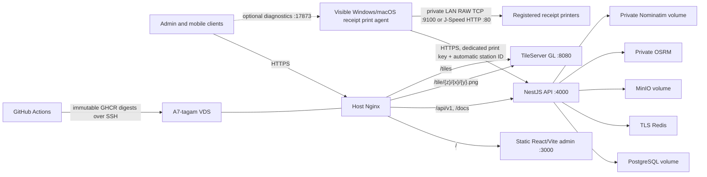

# A7-tagam infrastructure inventory

This document is the operational source of truth for the currently deployed
infrastructure. It records names, responsibilities and recovery procedures,
never secret values. Update it in the same commit whenever a host, public URL,
port, service, volume, GitHub setting, registry or deployment branch changes.

Last audited: 2026-09-12.

## Current answer: production only

The only active deployment is production. `main` builds hardened immutable
containers and targets the single VDS through the GitHub `production`
Environment. Hosted-runner deployment is currently blocked at the domestic SSH
boundary, so the active release used the audited workstation fallback described
below. The runtime declares both `NODE_ENV=production` and
`DEPLOYMENT_ENVIRONMENT=production` and uses PostgreSQL, TLS Redis, MinIO,
TileServer GL, OSRM and Nominatim on the private Compose network.

Production traffic uses the Telecom-issued certificate at
`https://a7-tagam.com.tm`; port 80 only redirects to that canonical HTTPS
origin. During customer testing, two env-only allowlisted accounts have a
time-boxed reusable OTP exception through 2026-09-17; its phone numbers and code
exist only in the protected server env and encrypted GitHub `production`
Environment secrets.
All other accounts use the Android pull SMS gateway, and the allowlisted
accounts return to it automatically after expiry. Off-host backups and external
monitoring/alerting still need to be completed.

The repository contains the operations admin, not a customer web storefront.
Android/iOS applications remain separate projects and consume this API/map
contract; they are not built or released by this monorepo. ChatGPT Sites and
Cloudflare Workers are not deployment targets.

## Topology



TileServer provides only the visual base map. Courier GPS, orders, customer
data and route authorization always pass through NestJS. OSRM and Nominatim are
never public client endpoints.

## Host and capacity

| Item | Current value |
| --- | --- |
| Host name | `a7-tagam` |
| Public IP | `216.250.12.132` |
| OS | Ubuntu 26.04 |
| Capacity | 4 vCPU, 3910 MB RAM, 60 GB-class disk |
| Swap | 2047 MB |
| Deployment directory | `/opt/alowalow/production` |
| Compose project | `alowalow-production` |
| Runtime env | `.env.production`, owner `ubuntu`, mode `600` |
| Release manifest | `.release.env`, immutable image digests, no secrets |
| Pre-switch archive | `/opt/alowalow/archive-pre-production-20260815` |

After the production cutover, roughly 29 GB of the root disk was free and
2.7 GB RAM was available. Retained immutable images and the offline migration
snapshot intentionally consume additional temporary space. Cleanup must never
remove named volumes or runtime map/routing directories.

The pre-switch directory and the three legacy `alowalow-development_*` volumes
are offline rollback snapshots, not an active DEV environment. They must not be
started or treated as DEV. Keep them only until the production backup/restore
procedure and customer acceptance are complete, then remove them through a
separately approved cleanup.

## Host software

| Component | Audited version/status |
| --- | --- |
| Docker Engine | `29.1.3`, enabled |
| Docker Compose plugin | `2.40.3` |
| Nginx | `1.28.3` Ubuntu, enabled |
| OpenSSH | `10.2p1` Ubuntu; `ssh.socket` enabled |
| OpenSSL | `3.5.5` |
| Certbot | isolated `5.7.0` virtual environment under `/opt/alowalow/tools/` |

Certbot has no active renewal timer. Turkmen Telecom owns certificate issuance
and renewal; A7-tagam operations validates and installs the supplied files on
the VDS. The active Sectigo certificate covers `a7-tagam.com.tm` and
`www.a7-tagam.com.tm`, is valid from 2026-08-19 through 2027-03-05, and is
installed as root-owned files under `/etc/nginx/ssl/a7-tagam.com.tm/` with the
private key at mode `600`. The VDS has no VPN and does not build the Node.js
applications. GitHub Actions builds the images and the VDS only pulls immutable
digests. No permanent GHCR credential is stored on the host.

## Public and internal URLs

Active same-origin production URLs:

```text
https://a7-tagam.com.tm/
https://a7-tagam.com.tm/orders
https://a7-tagam.com.tm/accounting
https://a7-tagam.com.tm/couriers/map
https://a7-tagam.com.tm/courier
https://a7-tagam.com.tm/api/v1
https://a7-tagam.com.tm/docs
https://a7-tagam.com.tm/docs-json
https://a7-tagam.com.tm/tile/{z}/{x}/{y}.png
https://a7-tagam.com.tm/tiles/styles/alowalow/style.json
```

The operations admin uses canonical client-side routes for every sidebar
section: `/orders`, `/accounting`, `/couriers/map`, `/branches`, `/catalog`, `/marketing`,
`/delivery`, `/notifications`, `/staff`, `/contacts`, and `/login-attempts`.
The isolated `/courier` route is not an admin section: it accepts a `COURIER`
workflow session for whole-shift GPS and assigned orders without exposing admin
navigation.
Static Nginx resolves direct loads of these paths to `/index.html`; React Router
then enforces the role-scoped view and renders it inside the shared admin
layout.

The admin and mobile base-map contract is the simple PNG XYZ `/tile/` URL. The
application build uses relative `/api/v1` and `/tile` paths. The source map
extract covers Turkmenistan; JSON/vector endpoints remain available for
advanced clients but are not required by the current admin/mobile integration.
Plain HTTP on the domain or server IP redirects to the canonical HTTPS domain.

## Ports and ingress

| Port/binding | Owner | Exposure |
| --- | --- | --- |
| `0.0.0.0:80` | host Nginx | redirect to canonical HTTPS |
| `0.0.0.0:22` | host sshd | administration |
| `0.0.0.0:443` | host Nginx | production HTTPS origin |
| `127.0.0.1:3000` | admin container | host Nginx only |
| `127.0.0.1:4000` | API container | host Nginx only |
| `127.0.0.1:8080` | TileServer GL | host Nginx only |
| Docker network only | PostgreSQL, Redis, MinIO, OSRM, Nominatim | not public |

The receipt print agent is a workstation runtime, not a VDS service. It claims
the durable queue directly over production HTTPS using a dedicated key and its
automatic persistent station ID; the browser is not involved. It also binds
`127.0.0.1:17873` on Windows or macOS for local diagnostics. It sends bounded print
requests to explicitly configured private printer IPv4 addresses over LAN port
80; neither the VDS nor Nginx exposes or routes that private traffic. The wired
workstation adapter uses the printer subnet without a gateway, while Wi-Fi may
continue to own internet access. PostgreSQL stores the audited main-printer
setting, category kitchen defaults and product overrides; the loopback agent
contains no routing configuration. A main and kitchen copy may intentionally
target the same physical IP and are sent as two bounded sequential jobs.

The active Nginx site is `a7-tagam-production.conf`. The versioned
`a7-tagam-http-temporary.conf` is retained only as historical rollback context
and must not be enabled while the TLS site is active. SSH listens only on 22.

## Runtime services and persistence

| Service | Purpose | Persistence |
| --- | --- | --- |
| `api` | NestJS business API | stateless container |
| `admin` | static React/Vite files on unprivileged Nginx | stateless container |
| `migrate` | `prisma migrate deploy` before API replacement | one-shot |
| `postgres` | users, orders, catalog, audit/history | named volume |
| `redis` | OTP, GPS latest point, SMS queue | intentionally ephemeral |
| `minio` | private product/banner images | named volume |
| `minio-init` | idempotent bucket creation | one-shot |
| `tileserver` | web/mobile OSM style, PBF and PNG tiles | host map runtime, read-only |
| `routing` | private OSRM road routing | host routing runtime, read-only |
| `geocoding` | private Nominatim search/reverse index | named volume |

The three active production data volumes are declared `external` in Compose.
This protects them from normal project replacement and `compose down
--volumes`; `prepare-production-host.sh` creates them explicitly on a new host.

Production pulls pinned MinIO server/client images from `nexus.telecom.tm`.
GitHub CI loads the same upstream amd64 image configurations from the repository
prerelease `ci-test-services-20260928`, asset
`minio-test-services-amd64.tar.gz`. The workflow checks its SHA-256 and both
upstream config digests before setting `MINIO_IMAGE` and `MINIO_MC_IMAGE`
Compose overrides. No new secret or registry login is needed. Docker Hub stopped
serving `minio/minio`; on 2026-09-28 Quay returned 401 and Telecom Nexus timed out
from the hosted runner. The archived images were recovered domestically from
Nexus and verified against the unchanged original pinned manifests. Local
development keeps its Quay defaults and cached multi-architecture images; Nexus
currently serves only cached amd64 artifacts. This CI dependency prerelease
must not replace a normal application release or its assets be overwritten.

All runtime images are pinned by digest. Repository-owned API, migration and
admin images come from GHCR. Third-party images that the VDS cannot fetch from
public Docker Hub are pulled through `nexus.telecom.tm` with their upstream
digest preserved.

Persistent data is not the same as a backup. Before final production, configure
and test encrypted off-host backups for PostgreSQL and MinIO, define retention,
and perform an actual restore drill. Nominatim can be rebuilt from the checked
Turkmenistan PBF but its volume should still be protected from accidental
deletion during ordinary releases.

## GitHub Actions settings

Workflow: `.github/workflows/ci-cd.yml`.

Active branch flow:

```text
feature branch -> pull request -> main -> quality gates -> GHCR -> production VDS
```

Repository variables:

| Name | Current value | Purpose |
| --- | --- | --- |
| `PRODUCTION_DEPLOY_ENABLED` | `true` | permit automatic production deployment |

GitHub Environment `production` variables:

| Name | Current value |
| --- | --- |
| `API_PORT` | `4000` |
| `ADMIN_PORT` | `3000` |
| `DEPLOY_SSH_PORT` | `22` |

GitHub Environment `production` encrypted secrets:

| Name | What it contains |
| --- | --- |
| `DEPLOY_SSH_HOST` | deployment host address |
| `DEPLOY_SSH_USER` | non-root deployment user |
| `DEPLOY_SSH_PRIVATE_KEY` | dedicated ED25519 private key |
| `DEPLOY_SSH_KNOWN_HOSTS` | verified host key for port 22 |
| `RECEIPT_AGENT_API_TOKEN` | dedicated print-agent key, atomically installed in the protected VDS env |
| `LONG_LIVED_TEST_OTP_PHONES` | temporary encrypted production test allowlist |
| `LONG_LIVED_TEST_OTP_CODE` | temporary encrypted reusable test code |
| `LONG_LIVED_TEST_OTP_EXPIRES_AT` | approved ISO expiry for the temporary exception |

The three `LONG_LIVED_TEST_OTP_*` secrets exist only for the approved testing
window. The deploy job validates the complete set, transfers it in a mode-600
temporary file, atomically updates the protected VDS env and deletes the
temporary file. Delete the three Environment secrets and clear the VDS fields
when testing ends. `GITHUB_TOKEN` is generated automatically for each job, is
used for a short-lived GHCR login over SSH stdin, and is followed by
`docker logout`; no permanent GHCR token is stored on the VDS.

The manually dispatched `Production operations` workflow is read-only: it can
inspect bounded API container status/logs through the same verified deploy key.
It cannot change env values, restart containers or deploy a release.

Only the GitHub `production` Environment participates in deployment and it
accepts only `main`. There is no active DEV Environment or DEV deploy job.

## Where application secrets live

Real runtime values live in `/opt/alowalow/production/.env.production` with
mode `600`. The application values also held by GitHub are the print-agent key
and the three temporary encrypted test-OTP Environment secrets described above;
they are available only to the protected production deploy job. Frontend builds
never receive backend secrets.

The VDS env contains these secret categories:

- database: `POSTGRES_*`, `DATABASE_URL`;
- auth/OTP: `JWT_ACCESS_SECRET`, `OTP_PEPPER`, token TTL settings;
- TLS Redis: `REDIS_PASSWORD`, `REDIS_URL` plus files under `redis-tls/`;
- Android SMS gateway: `SMS_PROVIDER`, `SMS_GATEWAY_DEVICE_ID`,
  `SMS_GATEWAY_AUTH_REQUIRED`, `SMS_GATEWAY_DEVICE_TOKEN`,
  `SMS_GATEWAY_ENCRYPTION_KEY`;
- receipt agent: `RECEIPT_AGENT_API_TOKEN`; the EXE sends its persistent station
  UUID automatically;
- S3/MinIO: `MINIO_*`, `S3_*`;
- Firebase push: `FCM_SERVICE_ACCOUNT_BASE64`, `PUSH_PROVIDER`;
- routing/geocoding provider origins and private Nominatim password;
- an optional time-boxed test OTP allowlist, code, expiry and explicit
  production acknowledgement; values exist only during approved testing.

Never print, copy into documentation, commit, or send any value from this
file. Rotation is done one secret at a time with a controlled API restart. JWT,
OTP pepper, encryption-key or database-password rotation may invalidate active
sessions/jobs and therefore requires a maintenance plan.

## Release and rollback

Every push to `main` must pass:

1. API lint, build, tests, coverage and full/production audits.
2. Admin lint, production Vite build, smoke/contract tests and audits.
3. Swagger contract regeneration with a clean Git diff.
4. Hardened API, migration and static Nginx image builds.
5. Production single-host Compose validation.
6. Go formatting, tests, vet, and cross-builds for Windows/macOS receipt-agent
   artifacts.

BuildKit publishes immutable digest references with provenance and SBOM. The
deploy job copies only Compose/release files, performs GHCR login with the
job-scoped token, pulls images, runs migrations, starts the stack and waits for
health checks. `.release.env` becomes active only after pulls succeed. If the
new stack is unhealthy, `deploy-production.sh` restores the previous release
manifest and starts the previous digests.

Telecom does not currently expose SSH port 22 to GitHub-hosted runners. Port
443 belongs exclusively to Nginx and must never be reused for deployment. A
domestic self-hosted runner or another Telecom-approved authenticated transport
is required before unattended deployment can succeed. Do not disable security
controls, store a permanent registry token or expose Docker to work around this
network issue.

On 2026-08-19 run `32238857443` published all three immutable GHCR images for
commit `890703c`, but hosted runners received `connection refused` on port 443
twice and timed out on a temporary port-22 attempt. The production Environment
variable is now `DEPLOY_SSH_PORT=22`; port 443 is reserved for HTTPS. The same
commit was therefore built for `linux/amd64` on the trusted domestic
workstation, every image label
was checked against the full Git SHA, and one checksum-verified Docker archive
was transferred over the existing ED25519 SSH access. No registry credential
was stored on the VDS. A local Compose override sets `pull_policy: never` only
for API, migration and admin; `.release.previous.env` remains the rollback
manifest. Migration and every Compose health check passed before Nginx reload.
The active `.release.env` temporarily references the three
`alowalow-local-*:sha-890703c...` images. The next successful standard GitHub
deploy will replace those references with GHCR digests. This is an audited
one-release fallback, not the new automatic deployment design; a stable
domestic runner or Telecom-approved inbound transport is still required.

## Operational checks

Public HTTPS checks:

```bash
curl --fail https://a7-tagam.com.tm/api/v1/health
curl --fail https://a7-tagam.com.tm/
curl --fail https://a7-tagam.com.tm/docs-json
curl --fail \
  --output /tmp/a7-tagam-map-tile.png \
  https://a7-tagam.com.tm/tile/10/677/395.png
```

Server checks:

```bash
cd /opt/alowalow/production
docker compose \
  --env-file .release.env \
  --file docker-compose.production.yml \
  --file docker-compose.single-host.yml \
  ps
docker stats --no-stream
df -h /
free -h
sudo nginx -t
```

Do not run `docker compose down --volumes`, `docker system prune --volumes`, or
delete `maps-runtime`, `routing-runtime`, `.env.production`, `redis-tls`, or
named volumes during routine deployment.

## Remaining production hardening

- GitHub deploy uses a reachable transport other than the HTTPS listener.
- `DEPLOYMENT_ENVIRONMENT=production` remains enforced and the temporary test
  OTP exception is removed no later than 2026-09-17.
- Renew and install the Telecom certificate before 2027-03-05, then repeat the
  key-pair, chain, Nginx and external TLS checks.
- Monitor Chrony synchronization and clock drift. During TLS activation on
  2026-08-19, Chrony had valid NTS sources but the host clock was 120,495
  seconds slow; `chronyc makestep` corrected it and the RTC was updated.
- PostgreSQL and MinIO encrypted off-host backups and restore tests exist.
- Monitoring, alerting, log retention and disk-capacity alarms exist.
- Android/iOS production builds use the HTTPS API and MapLibre style URLs.
- Security review, customer acceptance and rollback drill are complete.

## Future DEV environment (not active)

DEV must be added later as a separate deployment, never by changing the active
production runtime back to development. It needs its own GitHub Environment and
enable variable, deployment directory, Compose project, loopback ports,
PostgreSQL/MinIO/Nominatim data, Redis secrets, S3 bucket, Android gateway
identity and monitoring. A future branch policy can be chosen at that time;
until then only `main → production` exists. Production secrets and named
volumes must never be copied into DEV.

Detailed provisioning and TLS commands remain in `docs/DEPLOYMENT.md`; mobile
map integration remains in `docs/MOBILE_MAP_AND_ROUTING.md`.


## Local courier-road demonstration — 2026-09-12

The user requested a live local map demonstration, including road lines. Docker
Desktop was recovered from an unresponsive VM and the existing ignored
Turkmenistan graph is served by `alowalow-routing-routing-1` from
`routing/compose.yml`, using the unchanged pinned OSRM image. For this local
demo only, `ROUTING_PORT=59999` binds OSRM to `127.0.0.1:59999`; NestJS is
its consumer. The override avoids the macOS service already owning port 5000.
No production port, container, image or service was changed.

The demo frontend is `http://127.0.0.1:4319/demo`, its real NestJS API is on
loopback port 4000, isolated native PostgreSQL is on 55439 (`alofood_test`),
and isolated native Redis is on 56399 (DB 15). The task-owned native runtime
and PID files are under `/tmp/a7-courier-map-live/`; the demo runner is
`outputs/courier-map-20260912/road-demo.cjs`. These services are intentionally
left running for the user's interactive demonstration. Stop only this demo's
Node process, its native database/Redis and the `alowalow-routing` Compose
project when the user finishes; do not stop workstation printing.
